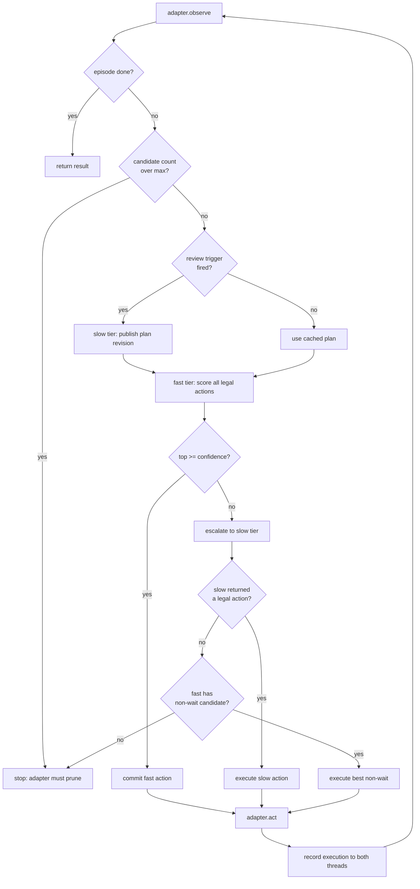

# The fast/slow decision loop

This document describes how one decision is produced, in the order the code
actually runs it. It is the map you need before changing either tier.

## One step

## Why the trigger set is shaped that way

Each trigger answers a different question, and they are OR-ed because any one of
them alone is insufficient:

`first step` — nothing is cached, so the fast tier would be choosing blind.

`low confidence` — the fast tier itself reports that the candidates are close. This
is the only trigger driven by the model's own uncertainty rather than by a
heuristic about the environment.

`scorer error or empty distribution` — the fast tier cannot answer at all, so its
opinion carries no information.

`recurrence >= 3 in window` — the agent has been in this public state repeatedly.
Either the plan is wrong or the actions are ineffective; both need the planner.

`phase / level / headings changed` — the situation the cached plan describes no
longer exists. Keeping a plan across a phase change is the most expensive kind of
staleness because the plan still *reads* correct.

`cell changed and >= 2 steps since review` — spatial movement without a phase change
still invalidates concrete coordinates while leaving the stage goal valid. The
two-step guard avoids reviewing after every single move.

`last three actions identical` — a local loop. The fast tier will keep picking the
same action because the observation keeps looking the same, so the loop cannot
break itself.

`interval elapsed` — a floor on review frequency so a long uneventful phase does not
drift on a stale plan.

## Why a failed review does not stop the episode

The review is an optimisation on top of a working fast loop, not a dependency of it.
This distinction was learned from a measurement: with the review treated as a
precondition, one empty response discarded the entire trajectory (4 steps instead of
37) because the first-step trigger always fires and therefore always has a chance to
fail at the worst possible moment.

The current rule keeps playing on the cached plan and counts consecutive failures,
stopping only at six. A sustained outage still terminates the run, so a dead planner
cannot silently spin the fast tier forever against nothing.

## The confidence gate

The fast tier returns probabilities over legal actions, so escalation is a threshold
rather than a separate model. Two properties matter:

The gate is on the *top* probability in absolute terms, not on the margin between
top and second. A distribution of 0.61/0.39 passes while 0.40/0.38/0.22 fails, which
matches the intent: "is this action clearly right" rather than "is it clearly
better than the alternative".

When escalation fails to produce an action, the fallback takes the best non-wait
candidate rather than stopping. Waiting is excluded because a wait action in a real
game usually means the game is offering it during a transition, and taking it on
failure converts a decision problem into an indefinite stall.

## What the slow tier publishes

Every response — whether from a scheduled review or a low-confidence escalation —
publishes one complete context revision. This is deliberate: partial updates let the
fast tier run with a new stage goal against an old play instruction, which produces
confident wrong behaviour.

The revision refreshes together:

`briefing` (stable), `stage_goal` (phase-scoped), `play_instruction` (stage-scoped),
`situation` (this review), review age, and the observation-bound action cache.

A new revision invalidates the previous compiled action-criteria map, so an old
directive cannot resurface when an old scene reappears.

## Optional: slow-authored per-action criteria

When enabled, the slow tier returns a usage condition for *every* legal action id,
not just the one it would pick. The fast tier then matches those conditions against
the current observation. This moves the "when is this action appropriate" reasoning
into the slow tier's budget and leaves the fast tier a pure matching task.

Completeness is enforced: the map is only used if it covers exactly the current legal
ids, and any unknown id rejects the whole map rather than being silently dropped.
A missing id would otherwise leave the fast tier unable to ever choose that action
while the criterion silently did not apply. The map is also invalidated whenever
phase, level or control meaning changes, because conditions are written against
observation fields.

This is opt-in (`slow_action_criteria`) and its effect on win rate is not yet
established — only that it produces the same action on the tested observations.

## Optional: slow-authored keyboard pruning

Games in the catalogue range from four-arrow mazes to a rhythm game that listens to a
single row of letters. If the adapter only offers arrows, a QWERTY rhythm game sits on
its instruction screen for the whole budget and records zero progress — which is
exactly what happened before this existed.

The adapter therefore publishes `state.input_universe`, the complete list of keys it
is physically able to send, and the slow tier returns the subset this specific game
demonstrably ignores. Three safeguards:

Ids outside the universe reject the entire response, because that is evidence the
model misread the input list, and applying the plausible half would be worse than
applying none.

An empty array is read as "not enough evidence yet" and keeps the cached subset. Only
an explicit `control_exclude_clear` removes it. Without this distinction, every
uncertain review would erase a verified decision.

The adapter refuses any subset leaving fewer than four keys, and click controls are
never prunable this way.

The fast tier is deliberately shown only the live legal tier, with the universe
stripped from its context, so it cannot name a key that is not available this step.

## Threads

Both tiers share `agent_harness.Thread` history, but they do not see the same view.
The slow tier gets the full review payload with the complete legal action list and the
fast tier's distribution. The fast tier gets the observation, the current criteria and
the slow tier's plan — never the full keyboard universe and never the slow tier's
private reasoning.

Both threads are fed the *actual executed* decision after the fact via
`record_execution`, tagged as history rather than as a fresh instruction. Without
that tag the slow tier would read its own executed actions as a new strategy response
and treat them as confirmation.
