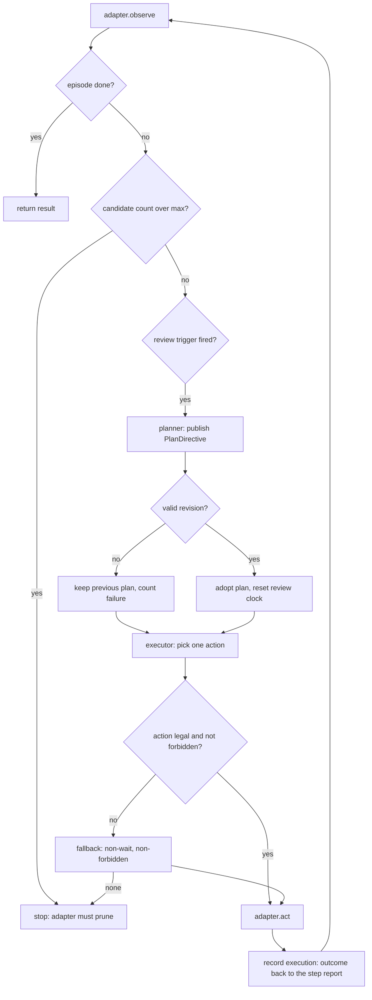

# The two-role decision loop

One decision, in the order the code runs it. Read this before changing either role.

## The change that defines this design

The two tiers used to differ in *capability*: a scoring endpoint (JEV) answered
"which of these candidates" and a chat model answered "what should we do". The
scorer could not name an action outside the list it was given, could not say why,
and had no way to express doubt except a softmax number. Three costs followed:

- every step had to enumerate and describe the full candidate list;
- the planner had to author a usage condition per action to make the list
  meaningful, which is the burden the split was supposed to remove;
- on a hard step the planner was asked for a single action, so the two tiers
  collapsed into one at the planner's latency and price.

Now both roles call the same ``chat/completions`` endpoint with the same model.
Everything that separates them is the role prompt plus the contract in
``general_agent/contract.py``. The split is along **responsibility**:

- the **executor** answers exactly one question per step: which legal control do I
  press now? It never sees the win condition, the keyboard universe or the budget.
- the **planner** answers whether the current stage plan still holds, and publishes
  a revision. It never names a control. The only way it can touch a specific frame
  is ``avoid`` (a prohibition) or ``exclude`` (a standing pruning of the input set).

## One step

## Triggers, in the order they are checked

Ordered by how much a review would add. Constants live in ``policy.py`` and the
trigger string is written into every training record, so a typo would silently
create a new class.

`first_step` — no plan exists at all.

`executor_error` — two consecutive failed reviews. The executor has no plan and no
way to ask again.

`executor_stuck` — the executor itself reported that the plan cannot be carried out
from here. This replaces the old "recurrence in window" heuristic: a self-report is
evidence, a repeating public state is a guess.

`phase_change` — phase, level or the legal action set changed. The cached tactics
describe a situation that no longer exists, which is the most expensive staleness
because the plan still *reads* correct.

`no_change` — the same action three times in a row. A local loop cannot break
itself, because the observation that justified the action also justified the repeat.

`low_confidence` — the executor's own number about its own choice fell below the
threshold. Unlike the old gate this is comparable across candidate counts, because
it is not a softmax mass over a list of varying length.

`plan_age` — the interval the planner asked for, clamped to the configured floor.
A planner may lengthen it when a plan is working; it cannot shorten it below the
floor, which is what stops the slow role from becoming a per-step caller.

## A failed review does not stop the episode

The review is an optimisation on top of a working executor, not a precondition of
it. This was measured the hard way: with the review as a precondition, a single
unparseable reply discarded a whole 37-step trajectory at step 4, because the
first-step trigger always fires and therefore always has a chance to fail at the
worst moment.

The current rule keeps executing on the previous plan and counts failures, stopping
at six. A sustained outage still ends the run, so a dead planner cannot spin the
executor forever against nothing. A rejected reply also leaves the previous
directive in place: an unparseable answer has said nothing about whether the plan is
wrong, so discarding it would lose a working plan over a formatting mistake.

## The contract

``contract.py`` is the only channel between the roles, and its field names are the
training labels. Lifetimes are declared rather than implied, fastest to slowest:

| field | lifetime | who reads it |
|---|---|---|
| `briefing` | whole episode | executor |
| `stage_goal` | one stage | executor |
| `tactics` | one stage | executor |
| `avoid` | one stage | executor (checked at execution) |
| `exclude` | whole episode | adapter (applied to the candidate list) |
| `situation` | one review | executor |
| `action` | one step | adapter |

The executor reports upward in `ExecutorStep`: `action`, `why`, `confidence`,
`expect`, `belief`, `stuck`, plus `repeat_run`, `plan_revision`, `plan_age` and the
`outcome` filled in after the fact. That report is the fast role's entire
contribution to the planner's context. It is a summary, not a transcript: sending
the planner every frame would make a review cost grow with episode length.

`expect` exists for one reason. The next observation is compared against it, and the
mismatch is the cheapest available signal that the plan is wrong. It costs no model
call, so it is recorded every step.

## Encoding is part of the contract

Both prompts are rendered by ``render_executor_payload`` /
``render_planner_payload`` from declared fields only, then serialised by
``encode()`` with pinned separators and preserved key order. Two identical
situations therefore produce identical bytes, which is what makes the recorded
prompt a usable training artifact rather than a description of one.

A field that is not in a dataclass cannot reach a prompt. That is intentional: the
old design passed free-form dicts, so the fast tier's input shape drifted with
whatever prose the planner happened to write that review.

## Keyboard pruning

Games in the catalogue range from four-arrow mazes to a rhythm game that listens to
a single row of letters. If the adapter only offers arrows, that game sits on its
instruction screen for the whole budget.

The adapter publishes `state.input_universe` — every key it can physically send — and
the planner may return `exclude`, the ids this game demonstrably ignores. The
adapter owns the decision to apply it:

- ids outside the universe are dropped, since they are typos in a prohibition;
- the request is refused outright if it would leave fewer than four keys or no play
  key, and the refusal reason is kept so the next review can correct itself;
- excluding an id also excludes its physical alias (`key_w` and `move_up_alt` are
  the same key), otherwise the game would still receive the key.

The executor never sees the universe, so it cannot name a key that is not live this
step. `exclude` is enforced twice — by the adapter on the candidate list, and by
`PlanDirective.forbids()` at execution — because the plan is adopted before the next
observation exists.

## Visibility

| | executor | planner |
|---|---|---|
| legal actions this step | yes | yes |
| `state.input_universe` | no | yes |
| `state.hint` / `instructions` | no | yes |
| progress metric | yes | yes |
| executor evidence | its own | via `ExecutorStep` |
| plan | read-only | publishes |

The executor's ignorance is a feature: every fact it does not have is a decision it
cannot make badly. The planner's extra view is also deliberate — narrowing the
keyboard is a legitimate standing decision about a game, and it can only be made by
something that can see the whole keyboard.

## Distillation

`ModelClient` records every request/response pair in wire form, and the policies
stamp the accepted contract object onto the call as `label`. `RoleRecorder` writes
those to `roles.jsonl` per run:

- a call with `error` is a transport failure and is counted as `failed`;
- a call that arrived but whose label was rejected by validation is also `failed`,
  which is what makes a prompt regression visible as a validation rate;
- a call whose label is fine but whose step had no numeric progress metric is
  counted as `unproven` and not written, because an unverifiable row looks like
  supervision without being supervision;
- writes are pulled through `client.drain_calls()`, so the client stays unaware of
  the training pipeline and an unattended run cannot retain every prompt in memory.

Each row carries `schema`, `role`, `game`, `run_id`, `goal`, `step`,
`plan_revision`, `trigger`, `messages`, `label`, `raw_reply` and `progress`. A
dataset assembled across a refactor can therefore be filtered by `schema` instead of
silently mixing two incompatible prompt shapes.
